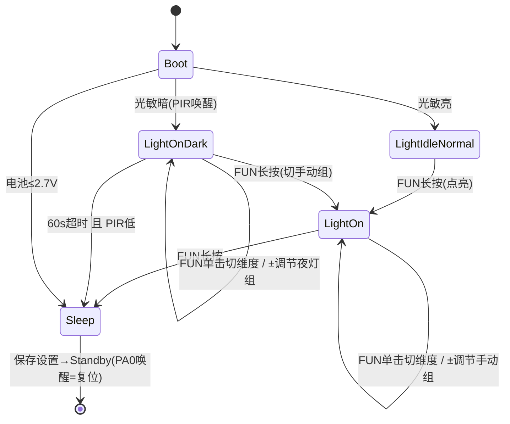

# STM32 冷暖色温夜灯 — 需求文档

- 状态：**已确认**（2026-10-13，第 1 轮，见 §11）
- 流程：需求文档确认 → 提交 → 设计文档 → 确认 → 实现代码（每阶段 git 提交）
- 依据：原始项目 C 固件源码逆向整理
  - 参考代码：`/mnt/MyFiles/Projects/CLionProjects/embeded/stm32f0_light/Core/`
  - 模块：`app.c` `key.c` `pwm.c` `adc.c` `rgb.c` `flash.c` `main.c` `stm32f0xx_it.c`
- 硬件资料：`hardware/datasheet/`（AS312 人体感应、CMFA104J3950HANT NTC）

---

## 1. 产品概述

电池供电的冷暖双色 LED 台灯/夜灯：

- 亮度、色温（暖/冷混合比例）两维可调，3 按键交互；
- 暗环境下由 PIR（人体红外）触发夜灯模式，超时自动睡眠；
- 电池电压监测 + 低电量保护；LED 板 NTC 测温 + 过热降亮保护；
- 设置掉电保存（内部 Flash）；深度睡眠（Standby）+ PA0 唤醒，静态功耗最小化。

## 2. 硬件平台

### 2.1 MCU

| 项目 | 值 |
|---|---|
| 型号 | STM32F030F4P6（Cortex-M0，TSSOP20） |
| Flash / RAM | 16 KB / 4 KB |
| 时钟 | 无外部晶振；HSI 8 MHz × PLL ÷1 = 48 MHz SYSCLK；HSI14 供 ADC |
| 调试 | SWD（PA13/PA14） |

### 2.2 引脚分配（`main.h`）

| 引脚 | 功能 | 方向/说明 |
|---|---|---|
| PA0 | PIR 传感器 / WKUP1 | 输入，下拉；高电平 = 检测到人；Standby 唤醒源 |
| PA1 | 电池电压 ADC（CH1） | 模拟；100K/47K 分压，系数 ≈ 3.13 |
| PA2 | 光敏电阻 ADC（CH2） | 模拟；5516 光敏，判黑暗环境 |
| PA3 | NTC 测温 ADC（CH3） | 模拟；100K B3950，LED 板温度 |
| PA4 | FUN 键 | 输入，低电平有效 |
| PA5 | CTRL−（减）键 | 输入，低电平有效 |
| PA6 | CTRL+（加）键 | 输入，低电平有效 |
| PA7 | 暖光 PWM | TIM14_CH1（见 §9-Q7 命名矛盾） |
| PA9 | 冷光 PWM | TIM1_CH2 |
| PA10 | TPS63802 模式选择 | 输出；低 = PFM（睡眠前拉低省电），高 = PWM |
| PB1 | 状态灯 R | 输出，低电平点亮 |
| PF0 | 状态灯 G | 输出，低电平点亮 |
| PF1 | 状态灯 B | 输出，低电平点亮 |

### 2.3 外部电路参数

- 电池分压：R1 = 100K（上），R2 = 47K（下），$V_{bat} = V_{adc} \times 3.13$。
- NTC 电路：固定电阻 100K 接 VCC，NTC（100K B3950）接地，ADC 采 NTC 两端电压；
  $R_{NTC} = \dfrac{ADC \times 100000}{4095 - ADC}$（单位 Ω）。
- 电池供电，经 TPS63802 升降压给系统供电。

## 3. 资源与性能约束

- **Flash ≤ 16 KB，RAM ≤ 4 KB**（C 版链接脚本：堆 0x200、栈 0x400）；禁止大缓冲、深递归。
- 裸机 superloop，无 RTOS；1 ms 系统节拍（SysTick）。
- PWM 频率 10 kHz（48 MHz / 4800 计数，ARR = 4799，PSC = 0）。
- ADC 12 位，采样时间 239.5 周期，每次读数取 8 样本平均，样本间延时 1 ms（阻塞式）。
- 按键扫描周期 10 ms（SysTick 内调度）。

## 4. 功能需求

### FR-1 电源与睡眠管理

- **FR-1.1** 上电/复位后区分复位源（`preSetup`）：
  - 从 Standby 唤醒（SB 标志置位）：清除 SB 标志，**禁用** WKUP 引脚功能（下次睡前再使能）；
  - 正常上电：使能 PWR 外设时钟；
  - 两种情况均清除 WUF 唤醒标志。
- **FR-1.2** 进入睡眠（STATE_SLEEP 处理）：保存设置到 Flash → 状态灯熄灭 → PWM 输出 0 → PA10 拉低（PFM）→ 使能 WKUP1（PA0）→ 进入 Standby。
- **FR-1.3** Standby 下仅 PA0 上升沿唤醒；唤醒等效一次复位，重新走启动流程。
- **FR-1.4** 电池电压低于低电阈值时进入低电流程：红灯闪烁 20 s 后走标准睡眠序列进入 Standby（替代 C 版"立即睡眠"，见 FR-11）。

### FR-2 灯光输出（`pwm.c`）

- **FR-2.1** 统一接口 `SetBrightnessAndCCT(bright, cct)`：
  - `bright`：0–100，总亮度；`cct`：0–100，色温，**0 = 全冷，100 = 全暖**。
  - $duty_{warm} = \lfloor\lfloor bright \times cct / 100\rfloor \times 4800 / 100\rfloor$（TIM14_CH1）
  - $duty_{cold} = \lfloor\lfloor bright \times (100-cct) / 100\rfloor \times 4800 / 100\rfloor$（TIM1_CH2）
  - 即亮度在两通道间按色温比例分配，总光通量近似恒定。
- **FR-2.2** 取值范围：亮度 5–100（下限 5），色温 0–100（调节时实际钳位 5–100，见 §9-Q3）。

### FR-3 按键输入（`key.c`）

- **FR-3.1** 3 个独立按键（FUN / CTRL− / CTRL+），低电平有效；每 10 ms 扫描一次。
- **FR-3.2** 去抖：电平稳定 30 ms（3 个扫描节拍）才确认。
- **FR-3.3** 事件定义：

| 事件 | 判定 |
|---|---|
| CLICK | 按下 < 800 ms 后释放，且不在双击等待窗口内 |
| DOUBLE_CLICK | 双击窗口（350 ms）内再次短按 |
| LONG_PRESS | 按住达 800 ms 触发一次；**释放时再触发一次**（C 现状） |

- **FR-3.4** 事件寄存器读取即清零（每键一个待处理事件，新事件覆盖旧事件）。
- **FR-3.5** C 代码中 `PRESS` / `RELEASE` / `LONG_HOLD` 事件定义了但从未产生（见 §9-Q2）。

### FR-4 运行模式（状态机，详见 §6）

- **FR-4.1** 启动流程（`App_Setup`）：复位源处理 → 读 Flash 设置（手动组 + 夜灯组）→ 光敏判断：
  - 暗（ADC > 4000）：直接以夜灯组亮度点亮，记 `dark_light_start_time`，进 STATE_LIGHT_ON_DARK；
  - 亮：进 STATE_LIGHT_IDLE_NORMAL（灯灭）。
  - 随后执行一次电池检查（决定状态灯颜色或直接睡眠）。
- **FR-4.2** STATE_LIGHT_IDLE_NORMAL：FUN 长按 → 以手动组亮度点亮（见 §9-Q1 状态不迁移问题）。
- **FR-4.3** STATE_LIGHT_ON：FUN 长按 → 睡眠；FUN 单击 → 切换调节维度（亮度 ↔ 色温）；CTRL± 单击/长按期间 → 当前维度 ±5；CTRL± 双击 → 亮度直达 100 / 5。
- **FR-4.4** STATE_LIGHT_ON_DARK：FUN 长按 → 切到手动组亮度并进 STATE_LIGHT_ON；FUN 单击 → 切换调节维度；CTRL± 单击/长按 → 夜灯组当前维度 ±5；CTRL± 双击 → 夜灯亮度直达 100 / 5。
- **FR-4.5** STATE_SLEEP：按 FR-1.2 执行后常驻。

### FR-5 夜灯模式（PIR）

- **FR-5.1** 进入：启动时光敏判定为暗（PIR 唤醒后即处于此模式）。
- **FR-5.2** 自动退出：进入后满 60 s 且 PA0（PIR）为低 → PWM 输出 0、保存夜灯组设置、进睡眠。
- **FR-5.3** 夜灯亮度/色温（dark 组）与手动组独立保存、独立调节。

### FR-6 电池管理（`adc.c` + `app.c`）

- **FR-6.1** 电压 = ADC(CH1) 均值 × 3.3 / 4095 × 3.13。
- **FR-6.2** 分档指示（状态灯，基础层显示）：

| 电压 | 指示 |
|---|---|
| > 3.7 V | 绿 |
| > 3.3 V | 黄（红+绿） |
| > 2.7 V | 红 |
| < 2.7 V | 低电流程：红灯闪烁 20 s → 睡眠（FR-11） |

- **FR-6.3** 检查频率：**每 1 s 采样并判定一次**（节流，替代 C 版每循环阻塞采样）；过热处理期间跳过电量判定。

### FR-7 温度保护（`adc.c` + `app.c`）

- **FR-7.1** NTC 阻值换算见 §2.3；阈值（Q4 修复后单位为 Ω）：$R \le 15\,\mathrm{k}\Omega$ 判过热（≥ 75 ℃ 附近），$R \ge 25\,\mathrm{k}\Omega$ 判恢复（≤ 60 ℃ 附近）。采样与判定**每 1 s 一次**（与 FR-6.3 同节流）。
- **FR-7.2** 过热时状态灯紫色；持续过热 ≥ 60 s 后开始降亮度（下限 5，色温不变）。
- **FR-7.3** 恢复后清除过热计时，按当前模式对应组恢复亮度（手动模式用手动组，夜灯模式用夜灯组，Q5 修复），并按 FR-10 渐变。

### FR-8 状态指示灯（`rgb.c`）

- **FR-8.1** 红绿蓝共阴（低电平点亮）组合色：红、绿、蓝、黄（R+G）、紫（R+B）、白（R+G+B）、全灭。
- **FR-8.2** 显示内容与优先级（高 → 低，**优先级方案待确认 D1**）：

| 优先级 | 场景 | 显示 |
|---|---|---|
| 1 | 低电流程（FR-11） | 红灯 1 Hz 闪烁 20 s → 睡眠 |
| 2 | 过热（FR-7.2） | 紫色常亮 |
| 3 | FUN 单击切换维度后 2 s | 手动：白=亮度 / 黄=色温；夜灯：**紫=亮度 / 蓝=色温**（FR-8.3） |
| 4 | 基础层（其余时间） | 电池电量色（FR-6.2），随 1 s 电量检查刷新 |

- **FR-8.3** 夜灯模式独立的亮度/色温子模式指示：紫（亮度）/ 蓝（色温）；手动模式对应白（亮度）/ 黄（色温）。
- **FR-8.4** 睡眠全灭。

### FR-9 参数持久化（`flash.c`）

- **FR-9.1** 位置：内部 Flash 最后一页（0x08003C00，1 KB 页）。
- **FR-9.2** 格式（小端，逐字写入）：

| 偏移 | 大小 | 字段 | 说明 |
|---|---|---|---|
| 0 | 4 | magic | 0xAA55AA55 |
| 4 | 1 | brightness | 手动组亮度 |
| 5 | 1 | cct | 手动组色温 |
| 6 | 1 | dark_brightness | 夜灯组亮度 |
| 7 | 1 | dark_cct | 夜灯组色温 |
| 8 | 1 | checksum | 前 8 字节 XOR |

- **FR-9.3** 保存 = 擦除整页后重写（先读改写保留另一组字段）；保存时机：进入睡眠时保存两组（含夜灯超时路径）。
- **FR-9.4** 加载校验 magic + checksum；失败用默认值：手动组 (5, 50)，夜灯组 (10, 45)。

### FR-10 灯光渐变（原原型增强，纳入初始实现）

- **FR-10.1** 亮度过渡一律 1 s 线性渐变（仅亮度维度，色温瞬时生效）：
  - 开机点亮：0 → 目标亮度；
  - 关机/超时睡眠：当前 → 0，**渐灭完成后再保存并进入 Standby**；
  - 夜灯 → 手动切换：夜灯亮度 → 手动亮度；
  - 过热恢复：→ 当前模式亮度。
- **FR-10.2** 渐变期间忽略按键事件；± 步进与双击直达为瞬时变化（不渐变）。
- **FR-10.3** 过热降亮仍按 FR-7.2 公式渐降（与渐变机制独立）。

### FR-11 低电保护（原原型增强，纳入初始实现）

- **FR-11.1** 判定：电池电压 < 2.7 V 进入低电状态；≥ 3.1 V 解除（迟滞，**待确认 D2**）。
- **FR-11.2** 低电状态：状态灯红灯 1 Hz 闪烁，持续 20 s。
- **FR-11.3** 闪烁 20 s 后：灯光渐灭（FR-10）→ 标准睡眠序列（FR-1.2）→ Standby。期间任意低电再次确认重新计时无必要——计时只启动一次，直至睡眠或解除。

### FR-12 调试日志（原原型增强，纳入初始实现）

- **FR-12.1** RTT 日志，编译期 feature `rtt` 控制（默认开启；release 可关闭以省空间）。
- **FR-12.2** 记录内容：状态切换、按键事件、电量电压、NTC 阻值/过热状态、睡眠原因。

## 5. 时序需求

| 项目 | 值 |
|---|---|
| 系统节拍 | 1 ms（SysTick） |
| 按键扫描 | 10 ms 周期（SysTick 内 `tick % 10 == 0` 调度） |
| 去抖 / 长按 / 双击窗口 | 30 ms / 800 ms / 350 ms |
| 电池 / 温度采样判定 | 每 1 s（节流） |
| 渐变时长 | 1 s 线性（FR-10） |
| 夜灯自动睡眠 | 进入后 60 s（PIR 持续低电平前提） |
| 过热降亮起始 | 过热持续 60 s 后 |
| 低电闪烁 | 1 Hz，持续 20 s 后睡眠 |
| 模式指示保持 | FUN 单击后 2 s |
| ADC 采样 | 8 样本平均 |

## 6. 状态机

### 各状态按键行为矩阵（C 固件现状）

| 状态 | FUN 单击 | FUN 长按 | CTRL± 单击/长按 | CTRL± 双击 |
|---|---|---|---|---|
| LightIdleNormal | — | 点亮（手动组）※ | — | — |
| LightOn | 切换维度 | 睡眠 | 手动组 ±5 | 亮度 100/5 ※ |
| LightOnDark | 切换维度 | 切手动组 → LightOn | 夜灯组 ±5 | 夜灯亮度 100/5 |
| Sleep | 不处理（已 Standby） | — | — | — |

※ 标注项为 C 代码疑似缺陷，见 §9。

## 7. 持久化数据与默认值汇总

- 手动组默认：亮度 5、色温 50（RAM 初值与 Flash 缺省一致）。
- 夜灯组默认：亮度 10、色温 45（Flash 缺省）/ 50（RAM 初值，不一致，见 §9-Q3）。

## 8. 迁移范围（Rust）

**目标**：在本仓库 `software/stm32f0_light/` 实现 Rust 固件（`no_std`，`thumbv6m-none-eabi`），行为 = C 固件（Q1–Q6 修复后）+ 增强特性 FR-10/11/12、FR-8.3、FR-6.3。

- 模块划分：`bsp`（pwm / key / adc / rgb / flash / 电源）+ `app`（状态机与业务）+ 时钟与外设初始化。
- 保留 Flash 数据格式（§FR-9.2）字节级兼容，旧 C 固件保存的设置可被读取。
- 纯逻辑（状态机、按键手势、钳位、PWM 映射、渐变、校验和）做成可在主机上单元测试的结构。

**非目标**：不迁移 CubeMX/HAL C 代码；增强清单（FR-10/11/12）之外不新增产品功能。

## 9. 已知问题与歧义（需逐项决策）

> 以下均为 C 固件实际行为，移植前需决定"修复"还是"保留"。

| # | 问题 | 证据 | 建议 |
|---|---|---|---|
| Q1 | **正常模式无法调节**：LightIdleNormal 长按点亮后状态不迁移到 LightOn，±键在该状态无处理，灯亮了却调不了 | `app.c` STATE_LIGHT_IDLE_NORMAL 分支只调 PWM 不改 `cur_state` | 修复：长按后进 LightOn |
| Q2 | 长按期间持续调节依赖 `KEY_EVENT_LONG_HOLD`，但 key.c 从不产生该事件（只在按住到 800 ms 时产生一次 LONG_PRESS，长按调节只能步进一次）；`PRESS/RELEASE` 同样是死代码 | `key.c` vs `app.c` 引用 | 修复：长按期间周期性产生 LONG_HOLD |
| Q3 | 小不一致：① 双击直达亮度只写 PWM 不更新 `cur_led_level[0]`（后续调节跳变）；② 色温下限被钳到 5 而非 0；③ 夜灯组 RAM 初值色温 50 vs Flash 缺省 45 | `app.c` 双击分支、`App_LEDMinus` | 修复：双击同步状态值；其余按 FR-2.2 统一 |
| Q4 | **NTC 单位不匹配**：换算返回 Ω（约 15000–25000），阈值却是 15/25，过热分支实际永不触发（恒走"温度正常"分支） | `adc.c` 换算 vs `adc.h` TEMP_THRESHOLD | 修复：阈值改为 15000/25000 Ω（对应 75 ℃/60 ℃） |
| Q5 | 过热降亮公式 `cur − 10×(now−high_temp_time)/high_temp_time` 分母是绝对 tick，非过热持续时长；且暗模式下恢复亮度用手动组 | `app.c` App_LEDTempCheck | 修复：按持续时长每分钟降 10%；恢复用当前模式对应组 |
| Q6 | 夜灯 60 s 计时从进入时刻起算、不随 PIR 重新触发复位（人一直在场 60 s 后也灭）；低电进 Standby 不保存设置、不拉低 PA10、不灭状态灯 | `app.c` dark 分支、App_BatteryVoltageCheck | 修复：PIR 触发复位计时；低电走标准睡眠序列 |
| Q7 | PA7/PA9 冷暖命名矛盾：`main.h` 标 PA7=Y_PWM、PA9=W_PWM；`pwm.c`/CLAUDE.md 标 PA7=暖、PA9=冷 | 两文件注释 | **需硬件确认**：以实测为准，代码常量一处定义 |

## 10. 验收标准

1. `cargo build --release`（thumbv6m-none-eabi）通过；产物 ≤ 16 KB Flash / ≤ 4 KB RAM 静态占用。
2. 行为核对表逐项通过：状态转移（§6）、按键矩阵（§6）、阈值与公式（FR-2/6/7）、Flash 格式兼容（FR-9）。
3. 主机端单元测试覆盖：状态机、按键手势时序、钳位与 PWM 映射、校验和/存取缺省。
4. （如有硬件）实机冒烟：开/关灯、亮度/色温调节、夜灯触发与超时睡眠、PA0 唤醒、断电重上电设置保持。

## 11. 决议与待确认点

**第 1 轮决议（2026-10-13）**

| 项 | 决议 |
|---|---|
| 迁移基准 | **以 C 固件行为为准**，Q1–Q6 修复；**原 Rust 原型增强（渐变/低电闪烁/子模式指示/1 s 节流/RTT）纳入初始实现**（FR-10/11/12、FR-8.3、FR-6.3） |
| 电量绿色阈值 | **> 3.7 V 显示绿色**（原 C 版 4.0 V） |
| §9 缺陷 Q1–Q6 | **全部按建议修复**（含按键语义：单击在双击窗口超时后才产生，双击不附带 CLICK；长按 800 ms 触发一次，其后每 200 ms 产生 LONG_HOLD） |
| Q7 冷暖映射 | **PA7 = 暖光（TIM14_CH1），PA9 = 冷光（TIM1_CH2）** |
| 验证标准 | §10 全部 4 项：单测 + 编译 + 实机冒烟 |
| 开发流程 | 需求文档确认 → git 提交 → 设计文档 → 确认 → 实现代码（每阶段 git 提交） |
| D1 灯色优先级 | **层叠优先级**：低电闪烁 > 过热紫 > 模式指示（FUN 单击后 2 s）> 电池色基础层 |
| D2 低电阈值 | **< 2.7 V 触发闪烁，≥ 3.1 V 解除**（迟滞） |

## 12. 实现记录（2026-10-13，S5 勘误）

**状态**：S1–S5 完成（commit：`6997ad2` 逻辑基础 / `ddc5be1` 状态机 / `852c253` BSP / `1aadbe6` 主循环+RTT）。`cargo test -p light-logic` 38 项全绿；三配置构建通过。

**实测体积**（arm-none-eabi-size）：

| 配置 | Flash | RAM (.data+.bss) |
|---|---|---|
| release（含 RTT） | 12 884 B | 1 096 B |
| release（`--no-default-features`） | 6 244 B | 8 B |
| dev | 13 000 B | 1 096 B |

**实现期细化（行为与本文档一致）**：

1. 渐变插值为 i32 向零截断线性（例：5→0 渐变 500 ms 处输出 3）；
2. 低电渐灭期间电压 ≥ 3.1 V（D2 解除阈值）会撤销睡眠并渐变回当前模式亮度（FR-11.3"直至睡眠或解除"）；
3. 电量档边界：2.7 V 恰值归 Red，仅 `< 2.7 V` 触发低电流程（D2 措辞优先）；
4. 日志中电压以整数 mV 输出（no_std 浮点格式化会多占 ~11 KB Flash）；
5. RTT 使用 `rtt_init_print!` 默认 1 KB 缓冲（RAM 占用已计入上表）；
6. 构建细节：`-Tlink.x` 经 `firmware/.cargo/config.toml` 注入；`cargo test` 必须在 workspace 根目录执行（firmware 目录下目标被固定为 thumbv6m）；dev profile 启用 `opt-level="s"`+LTO（16 KB Flash 装不下未优化代码）；
7. SysTick 节拍计数用 load/store（Cortex-M0 无 CAS，ISR 单写者安全）。

**遗留**：PA10 全程 PFM（保持 C 现状，设计文档 §3.4）；实机冒烟待硬件/探针就绪（清单：`docs/design.md` §6.3）。

## 附录 A：原仓库已有的 Rust 原型（参考，不作为需求基准）

原项目内存在一份已完成的 Rust 原型（`stm32f0_light/stm32f0_light/`，1720 行，进度账本 12 项全部完成），在 C 行为之外**额外增加**了：

- PWM 渐变（淡入/淡出，`fade.rs`）；
- 低电红灯闪烁 20 s 后睡眠；
- 夜灯模式独立的"亮度/色温"子模式指示（紫/蓝）；
- 电池/温度监控 1 s 节流（C 版每循环阻塞采样）；
- RTT 调试日志。

上述增强已全部纳入需求基准（渐变 FR-10、低电闪烁 FR-11、子模式指示 FR-8.3、1 s 节流 FR-6.3、RTT FR-12）；其余原型行为（如过热渐灭到 0、PA10 高电平运行）以本需求文档为准。原型 `fade.rs` 的 1 s 线性渐变参数被采纳。
